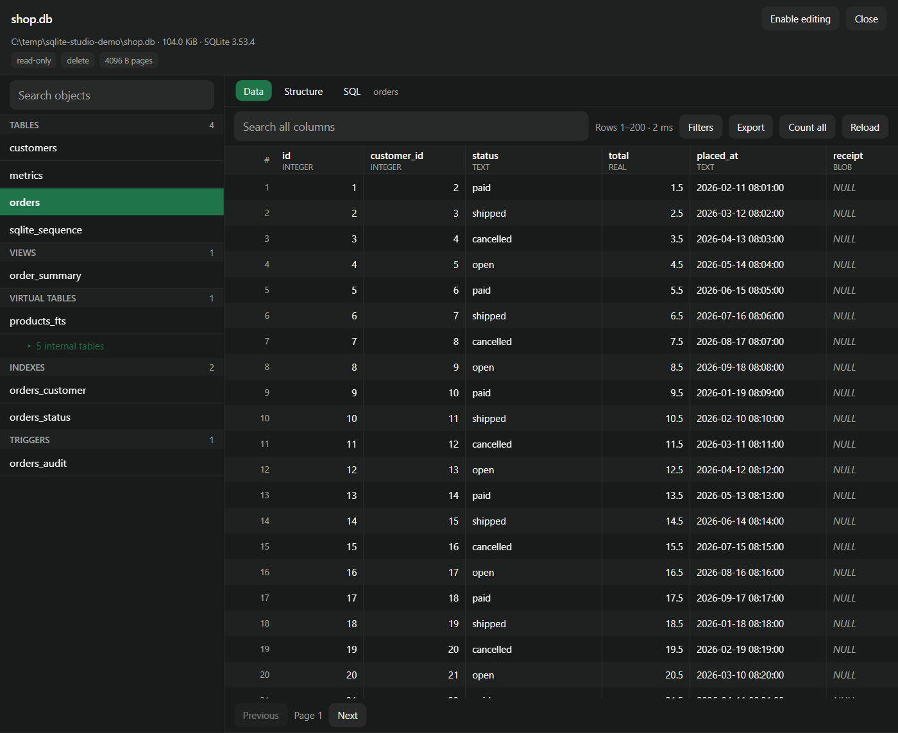
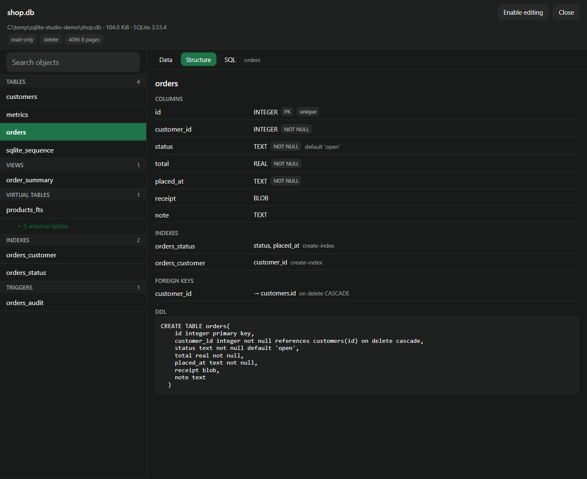
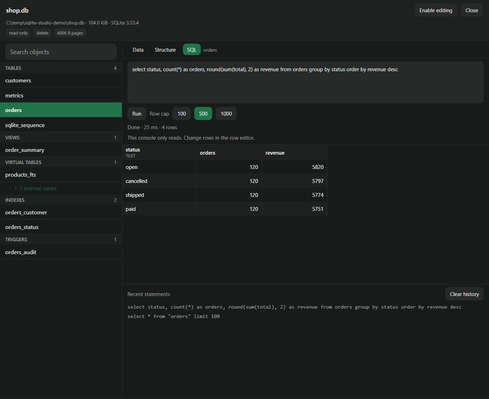

# SQLite Studio for Paseo

I look at SQLite files most days and got tired of leaving Paseo to do it. So this is a plugin that
puts a database browser in the sidebar: schema tree, row grid, read-only SQL console, exports, and
row editing when you ask for it.

The daemon does all the database work through `node:sqlite`. Only results cross the wire, which is
why a multi-gigabyte file opens right away and why a database on a remote host behaves the same as
one sitting next to you.

Up front: I used AI to write a good part of the code and to help with the docs. The ideas, the
feature list and the trade-offs are mine. Read the source like any third-party code, especially
before you turn on editing.

## Screens

Data and structure, side by side:

| Data | Structure |
| --- | --- |
|  |  |

The SQL console:



## What it does

- Opens `.db`, `.sqlite`, `.sqlite3`, `.db3`, `.s3db` and `.gpkg` files: type a path, use the file
  browser (it starts from your recent workspaces) or pick from recents.
- Schema tree for tables, views, virtual tables with their shadow tables, indexes and triggers,
  with counts per group.
- Per-object structure: columns with declared type and affinity, `NOT NULL`, defaults, primary key
  position, uniqueness, generated and hidden columns; index origin and columns; foreign keys with
  their actions; the original DDL.
- Virtualized row grid with sorting, global search and per-column filters (`=`, `≠`, `<`, `≤`,
  `>`, `≥`, `contains`, `not contains`, `starts with`, `ends with`, `is empty`, `is not empty`,
  `is NULL`, `is not NULL`).
- Full cell view: long text scrolls, blobs show as base64 with their size, `NULL` is not an empty
  string.
- SQL console with history and saved queries. Export a result as CSV, TSV, JSON, JSONL, Markdown,
  SQL inserts or HTML.
- Insert, update and delete rows after you enable editing for that database.
- Attachment source that puts a table's schema, keys and sample rows into a composer prompt.

## How it works

Databases open read-only. If another process holds a write lock, the plugin copies the file to a
snapshot in the daemon's temp directory, says so in the header and reads the copy. Editing stays
off until you enable it for a specific path; that setting is remembered.

Slow or unpredictable statements run in a worker thread as a job you can cancel, so one bad query
doesn't freeze the rest of the panel.

## Install

```sh
paseo plugin add git:SeriousM/paseo-sqlite-studio
```

Or from a checkout:

```sh
paseo plugin install /absolute/path/to/this/repository
```

Plugins run trusted and unsandboxed with the daemon user's access to the machine, files included.
Read the source before installing.

## Requirements

- Paseo 0.12.0 or later.
- Node 22.13 or newer on the daemon host. The desktop app bundles a suitable runtime; a daemon from
  npm or Docker uses the Node on that machine. The plugin says clearly when `node:sqlite` is
  missing.
- Opening a database from a file tab needs Paseo 0.13.0 or later. On 0.12 it still works from the
  plugin's own screen. The panel registration is feature-detected, so one build covers both.

## Development

```sh
pnpm install
pnpm typecheck
pnpm test
node tools/make-fixtures.mjs scratch   # sample databases for manual checks
paseo plugin reload paseo-sqlite-studio
```

`scratch/` holds generated databases and screenshots, and is not committed.
`pnpm-workspace.yaml` exempts the current Paseo SDK release from pnpm's minimum-release-age policy,
otherwise a freshly published version gets rejected on a clean install.

## Public now

The repository is public and this is the 1.1.1 release. I built the thing I wanted, so it follows my
own habits first. Bug reports and patches are welcome, keep them to the point.

## Layout

```
index.client.tsx     app entry: screen, sidebar item, command center, file panel, attachment source
index.server.ts      daemon entry: RPC handlers, jobs, settings
client/              React Native surfaces
server/              engine, introspection, queries, exports, mutations, jobs
shared/              Zod contracts, value encoding, settings, attachment definition
tests/               engine, schema, query, job, mutation, and attachment tests
```

## License

MIT
